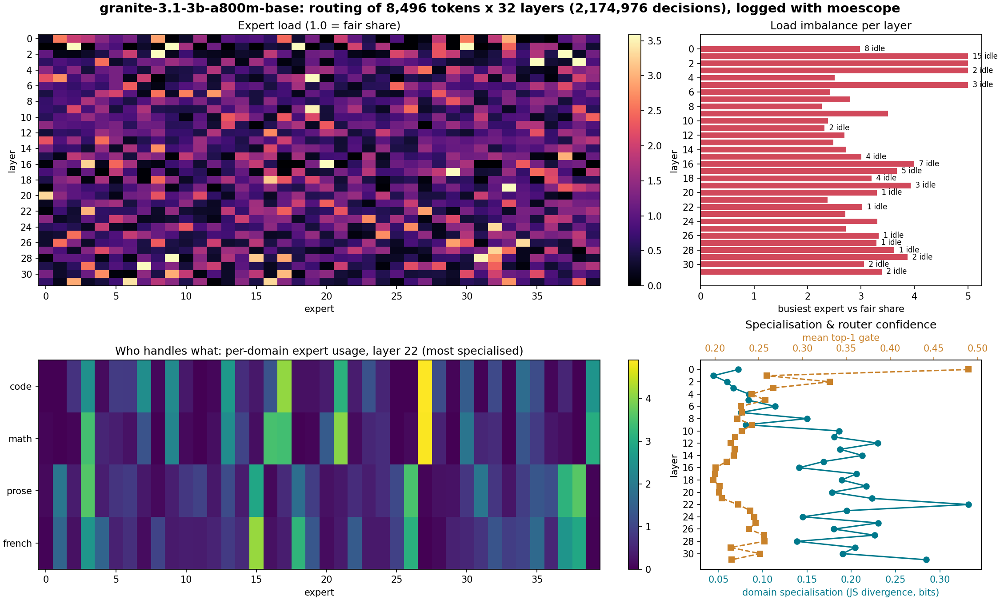
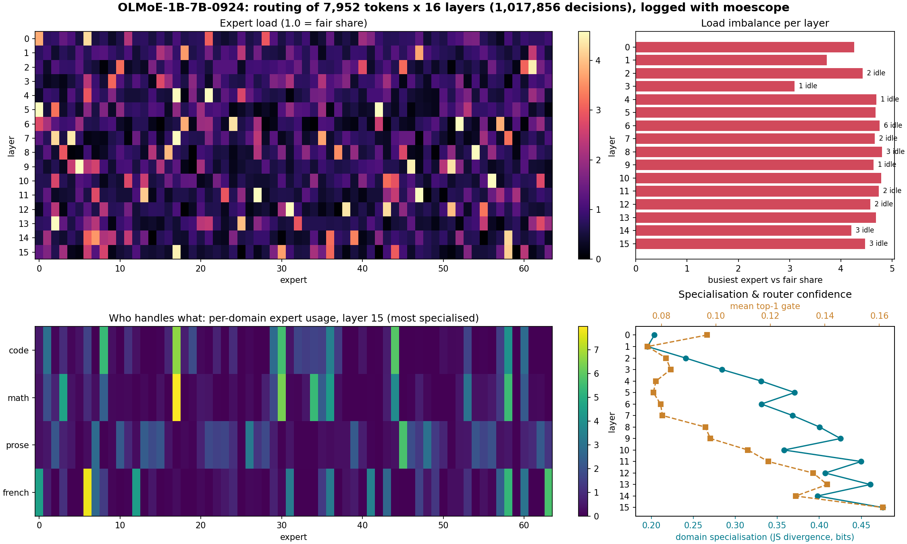

<div align="center">

# 🔬 moescope

**See exactly where every token goes inside a Mixture-of-Experts model.**

moescope logs every routing decision on the GPU, inside a CUDA kernel, and hands you the whole log in one call.


</div>


<p align="center"><sub>IBM Granite-3.1-1B-A400M on a free Colab T4: 1.63M routing decisions across code, maths, English and French.</sub></p>

---

## Why

MoE models send each token to a few of many experts. To find out which experts get overloaded, which sit idle and which ones specialise, you need **every** routing decision, and logging that from Python is slow: a naive `.cpu().tolist()` hook nearly **doubles** step time.

moescope keeps the whole log on the GPU instead:

```
router logits ──▶ CUDA kernel ──▶ 12-byte records in a GPU buffer ──▶ drain() ──▶ numpy
                  (top-k + gates)  (token, layer, expert, gate)        (one copy, at the end)
```

No host sync per step and no Python lists. Every decision is either logged or counted as dropped, so nothing goes missing silently.

## Results

Three MoE models from two labs, each hooked on every MoE layer and fed the same code, maths, English and French text on a single Tesla T4:

| | Granite-3.1-1B-A400M | Granite-3.1-3B-A800M | OLMoE-1B-7B |
|---|---:|---:|---:|
| Lab | IBM | IBM | AllenAI |
| Layers × experts, top-k | 24 × 32, top-8 | 32 × 40, top-8 | 16 × 64, top-8 |
| Gate mode | top-k → softmax | top-k → softmax | softmax → top-k |
| Decisions logged | **1,631,232** | **2,174,976** | **1,017,856** |
| Dropped | 0 | 0 | 0 |
| Match with the model's own router | **100.00%** (203,904) | **100.00%** (271,872) | **100.00%** (127,232) |
| Forward-pass cost of logging | +2.8%¹ | **+0.7%** | **+0.7%** |
| Busiest expert vs fair share | 1.8–4.0× | 2.3–5.0× | 3.1–4.8× |
| Near-idle experts (<10% of fair share) | 17 of 768 | 64 of 1,280 | 26 of 1,024 |
| Most domain-specialised layer | 14 | 22 | 15 |

"Match" compares moescope's expert set for every (layer, token) with the experts the model itself picked in the same forward pass.

The same pattern shows up in all three: in the most specialised layer, **code and maths share an expert** (Granite-1B layer 14: expert 13; Granite-3B layer 22: expert 27; OLMoE layer 15: experts 17 and 30), while prose and French spread across others. In OLMoE, routing gets both more domain-specific and more confident with depth.

<table>
<tr>
<td></td>
<td></td>
</tr>
<tr>
<td align="center"><sub>Granite-3.1-3B-A800M · 2.17M decisions</sub></td>
<td align="center"><sub>OLMoE-1B-7B · 1.02M decisions</sub></td>
</tr>
</table>

> Each run uses ~8k tokens of hand-written text. The numbers show what the log can reveal; they are not a study of these models. Granite-1B ran on Colab; Granite-3B and OLMoE on Kaggle (transformers 5.20).
>
> ¹ Measured with the earlier one-thread-per-token kernel; the other two use the current one.

## Quick start

```sh
pip install maturin
maturin build --release -F python,pyo3/extension-module,cuda-13000 -o dist
pip install dist/moescope-*.whl

python examples/analyze_routing.py      # → routing_report.png, routing_log.npz, summary.json
```

<details>
<summary>Other CUDA versions / CPU only</summary>

Choose the feature that matches the "CUDA Version" shown by `nvidia-smi`: `cuda-13000`, `cuda-12080`, `cuda-12040`, or `cuda-auto`.

CPU only (any OS, for trying it out):

```sh
pip install maturin && maturin develop --release
```

You need a Rust toolchain to build. The GPU build also needs the NVIDIA driver and NVRTC (from the CUDA toolkit).

</details>

## Usage

```python
import moescope

with moescope.attach(model) as session:      # finds every MoE router, reads the routing rule from the config
    model.generate(**inputs)                 # or training steps, or plain forward passes

log = session.drain()                        # structured numpy array, one row per decision
log["layer_id"], log["expert_id"], log["gate"], log["token_id"]
```

`attach` hooks each router and logs its own logits: one kernel launch per layer, no recomputation, no host sync. `token_id` counts tokens in processing order, so it keeps working across `generate` steps. Pass `check=True` and `session.parity(log)` compares the log with the experts and gates the model itself chose.

Supported routing. Families in **bold** are tested against the real transformers code in `tests/python/test_hf_attach.py` (every expert choice identical, gates within 1e-7); the others use routing code identical to a tested family:

| family | routing | moescope mode |
|---|---|---|
| **OLMoE**, **Qwen2/3-MoE**, **DeepSeek-V2** (`greedy`) | softmax over all experts → top-k (± renormalize, × scale) | `softmax_topk` / `topk_softmax` |
| **Mixtral**, **Granite**, MiniMax, HunYuan | top-k logits → softmax over the k | `topk_softmax` |
| **DeepSeek-V3**, **GLM-4.5**, **LFM2-MoE**, Kimi K2, dots1 | sigmoid + per-expert selection bias, group-limited top-k, renormalize, × scale | `sigmoid` with bias and groups |
| Llama 4 (not yet tested: its router doesn't expose the chosen experts) | top-k logits → sigmoid | `sigmoid` |

`attach` refuses what it can't reproduce exactly (DeepSeek-V2 `group_limited_greedy`, ERNIE-4.5) instead of logging something subtly wrong.

<details>
<summary>Lower-level API (no Hugging Face)</summary>

```python
moescope.configure(capacity=50_000_000, mode="sigmoid", normalize=True, scale=2.5, n_group=8, topk_group=4)
moescope.set_bias(layer_id=3, bias=router.e_score_correction_bias)      # once per layer
moescope.route_and_log(logits, k=8, layer_id=3, token_offset=offset)    # each step
log = moescope.drain()
```

- **Zero-copy:** a torch CUDA tensor is read in place: one pointer check, one kernel launch.
- **Overflow:** if the buffer fills up, `drain()` warns and `drain_with_stats()` returns the dropped count.

</details>

A full report (figure, raw log, `summary.json`):

```sh
python examples/analyze_routing.py                                       # Granite-3.1-1B-A400M
python examples/analyze_routing.py --model allenai/OLMoE-1B-7B-0924
python examples/analyze_routing.py --model LiquidAI/LFM2-8B-A1B --device-map auto
python examples/analyze_routing.py --toy deepseek_v3                     # tiny offline model
```

## Benchmark

A toy OLMoE (4 layers, 64 experts, top-8, 2,048 tokens per step) on a T4, logging every decision:

| strategy | step (ms) | overhead |
|---|---:|---:|
| no logging | 23.39 | – |
| Python lists, `.cpu().tolist()` | 42.84 | **+83.2%** |
| `.cpu()` tensors each step | 24.08 | +3.0% |
| tensors kept on GPU, `torch.cat` at end | 22.43 | within noise |
| **moescope** | **22.70** | **within noise** |

moescope costs about the same as keeping tensors on the GPU yourself. What it adds is a bounded, pre-allocated buffer, explicit drop counting, a fixed record format and a ready-made analysis report. Reproduce with `bench/bench_hook.py`.

## Stress test

`bench/stress_test.py` pushes the logging path far beyond a normal forward pass and checks every result against torch. All 21 checks passed on a T4:

| check | result |
|---|---|
| Correctness | 66 (experts, k, mode) combinations, E = 8 to 256, k = 1 to 32: **17.3M tokens**, every expert choice matches torch, worst gate error 9e-7 |
| Volume | **98.6M decisions (1.18 GB)** in one buffer, 0 dropped, per-expert histogram identical to torch's, drained in 4.8 s |
| Overflow | 3M decisions into a 1M-record buffer: kept exactly 1,000,000, counted exactly 2,000,000 dropped; buffer reusable after drain; 200 log/drain cycles |
| Odd inputs | all-equal logits, NaN, ±1e30, k = E, E = 65,536, fp16 / bf16, non-contiguous and 3-D tensors, logits produced on a side CUDA stream |

Throughput of one `route_and_log` call (T4, 1M tokens):

| experts, k | moescope | torch softmax + topk alone |
|---|---:|---:|
| 8, top-2 | **0.50 ms** (4.2 G decisions/s) | 17.5 ms |
| 32, top-8 | **3.9 ms** (2.2 G decisions/s) | 18.7 ms |
| 64, top-8 | **8.5 ms** (1.0 G decisions/s) | 25.7 ms |
| 128, top-8 | **18.3 ms** (0.46 G decisions/s) | 44.3 ms |

moescope routes, gates and logs every token faster than torch can merely pick the top-k, at every expert count tested. Each token is handled by a group of 2–32 threads (sized to the expert count): they read the row together in one coalesced pass, then pick the top-k in k rounds of warp-shuffle reductions. An earlier one-thread-per-token kernel was 2× *slower* than torch at 128 experts; this design made it 5× faster there.

## What it is / isn't

| It is | It isn't |
|---|---|
| A low-overhead recorder for load imbalance, dead experts and specialisation | A faster MoE router: the model's forward pass is unchanged |
| GPU kernels tested against a CPU reference (exact ids, gates within 1e-5) | Bit-identical to torch on exact ties (the lower expert index wins) |
| A fixed-capacity log that never grows without bound or silently loses data | |

## How it works

| path | role |
|---|---|
| `src/router.rs` | CPU reference router: softmax / sigmoid gating, selection bias, group-limited top-k, NaN-safe validation |
| `src/dispatcher.rs` | groups tokens per expert, builds the load histogram |
| `src/telemetry.rs` | the 12-byte `#[repr(C)]` record and a bounded host log |
| `src/gpu/kernels.rs` | CUDA C compiled at runtime with NVRTC: a lane group per token (warp shuffles), fused route + dispatch + log |
| `src/gpu/raw.rs` | the **only** module allowed `unsafe`; every block has a safety comment |
| `src/python.rs`, `python/moescope/` | PyO3 bindings, the numpy / torch API, and `attach()` for Hugging Face models (`hf.py`) |

<details>
<summary>Design notes</summary>

- **Ties and NaN:** the higher logit wins. On an exact tie the lower expert index wins. NaN ranks below every number.
- **Appending:** each token reserves its k log slots with one 64-bit `atomicAdd`. Records past capacity are counted as `dropped`, not written.
- **Foreign pointers:** a torch tensor's address is checked with `cuMemGetAddressRange` and its device ordinal is verified before the kernel reads it. The check works per driver allocation: torch pools tensors, so a wrong length could read a neighbouring tensor, but never unmapped memory.
- **Limits:** `k ≤ 32`, `num_experts ≤ 65,536`, and every flat index must fit in u32.

</details>

## Testing

```sh
cargo test                                # CPU: router, dispatch, telemetry, property tests
cargo test --features cuda-13000          # builds the GPU path (GPU tests skip without a driver)
python -m pytest -q tests/python          # Python bindings + attach() parity on 11 model configurations
bash scripts/colab.sh cuda-13000          # full GPU suite, ends with "ALL PHASES PASSED"
bash scripts/colab_models.sh              # GPU stress test + routing reports for Granite-3B and OLMoE
```

On a GPU machine, set `MOESCOPE_REQUIRE_GPU=1` so a missing driver fails the tests instead of skipping them.
