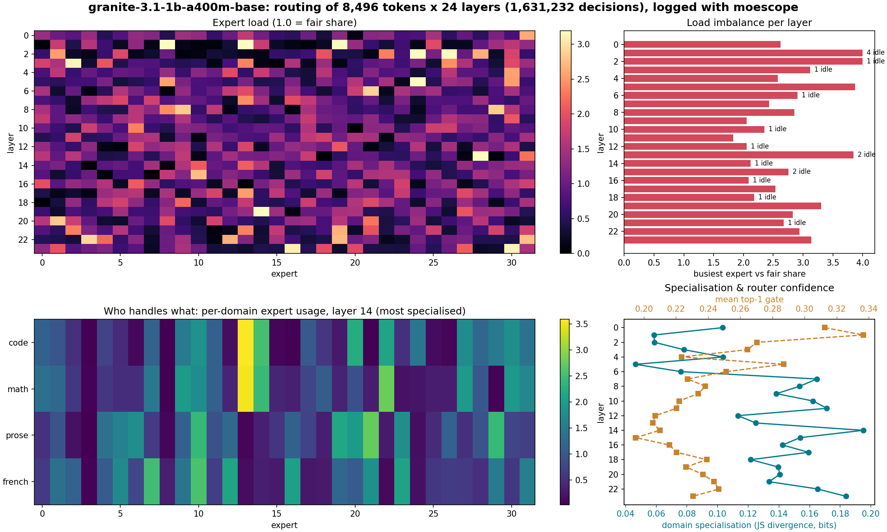

<div align="center">

# 🔬 moescope

**See exactly where every token goes inside a Mixture-of-Experts model.**

moescope logs every routing decision on the GPU, inside a CUDA kernel, and hands you the whole log in one call.


</div>



<p align="center"><sub>IBM Granite-3.1-1B-A400M on a free Colab T4: 1.63M routing decisions across code, maths, English and French.</sub></p>

---

## Why

MoE models send each token to a few of many experts. To find out which experts get overloaded, which sit idle and which ones specialise, you need **every** routing decision, and logging that from Python is slow: a naive `.cpu().tolist()` hook nearly **doubles** step time.

moescope keeps the whole log on the GPU instead:

```
router logits ──▶ CUDA kernel ──▶ 12-byte records in a GPU buffer ──▶ drain() ──▶ numpy
                  (top-k + gates)  (token, layer, expert, gate)        (one copy, at the end)
```

No host sync per step and no Python lists. Every decision is either logged or counted as dropped, so nothing goes missing silently.

## Results

Three MoE models from two labs, each hooked on every MoE layer and fed the same code, maths, English and French text on a single Tesla T4:

| | Granite-3.1-1B-A400M | Granite-3.1-3B-A800M | OLMoE-1B-7B |
|---|---:|---:|---:|
| Lab | IBM | IBM | AllenAI |
| Layers × experts, top-k | 24 × 32, top-8 | 32 × 40, top-8 | 16 × 64, top-8 |
| Gate mode | top-k → softmax | top-k → softmax | softmax → top-k |
| Decisions logged | **1,631,232** | **2,174,976** | **1,017,856** |
| Dropped | 0 | 0 | 0 |
| Match with the model's own router | **100.00%** (203,904) | **100.00%** (271,872) | **100.00%** (127,232) |
| Forward-pass cost of logging | **+2.8%** | **+1.5%** | **+2.8%** |
| Busiest expert vs fair share | 1.8–4.0× | 2.3–5.0× | 3.1–4.8× |
| Near-idle experts (<10% of fair share) | 17 of 768 | 64 of 1,280 | 26 of 1,024 |
| Most domain-specialised layer | 14 | 22 | 15 |

"Match" compares moescope's expert set for every (layer, token) with the experts the model itself picked in the same forward pass. In Granite-1B's most specialised layer, code and maths both lean on expert 13, while prose and French spread across others (figure above).

> Each run uses ~8k tokens of hand-written text. The numbers show what the log can reveal; they are not a study of these models. Granite-1B ran on Colab; Granite-3B and OLMoE on Kaggle (transformers 5.20).

## Quick start

```sh
pip install maturin
maturin build --release -F python,pyo3/extension-module,cuda-13000 -o dist
pip install dist/moescope-*.whl

python examples/analyze_routing.py      # → routing_report.png, routing_log.npz, summary.json
```

<details>
<summary>Other CUDA versions / CPU only</summary>

Choose the feature that matches the "CUDA Version" shown by `nvidia-smi`: `cuda-13000`, `cuda-12080`, `cuda-12040`, or `cuda-auto`.

CPU only (any OS, for trying it out):

```sh
pip install maturin && maturin develop --release
```

You need a Rust toolchain to build. The GPU build also needs the NVIDIA driver and NVRTC (from the CUDA toolkit).

</details>

## Usage

```python
import moescope

moescope.configure(capacity=50_000_000, mode="topk_softmax")  # 12 bytes per decision

def make_hook(layer_id):
    def hook(_module, _inputs, out):
        logits = out[0] if isinstance(out, tuple) else out
        moescope.route_and_log(logits, k=8, layer_id=layer_id)
    return hook

for i, layer in enumerate(model.model.layers):
    layer.block_sparse_moe.router.register_forward_hook(make_hook(i))  # OLMoE/Mixtral: layer.mlp.gate

model(**inputs)                     # run as usual

log = moescope.drain()              # structured numpy array
log["expert_id"], log["gate"]       # fields: token_id, layer_id, expert_id, gate
```

| | |
|---|---|
| **Gate modes** | `softmax_topk` for OLMoE / Switch · `topk_softmax` for Mixtral / Granite |
| **Zero-copy** | torch CUDA tensors are read in place: one pointer check, one kernel launch |
| **Overflow** | `drain()` warns; `drain_with_stats()` returns the dropped count |
| **Token ids** | pass `token_offset=` to keep ids unique across batches |

Try other models:

```sh
python examples/analyze_routing.py --model allenai/OLMoE-1B-7B-0924
python examples/analyze_routing.py --toy granitemoe        # tiny offline model, no download
```

## Benchmark

A toy OLMoE (4 layers, 64 experts, top-8, 2,048 tokens per step) on a T4, logging every decision:

| strategy | step (ms) | overhead |
|---|---:|---:|
| no logging | 23.39 | – |
| Python lists, `.cpu().tolist()` | 42.84 | **+83.2%** |
| `.cpu()` tensors each step | 24.08 | +3.0% |
| tensors kept on GPU, `torch.cat` at end | 22.43 | within noise |
| **moescope** | **22.70** | **within noise** |

moescope costs about the same as keeping tensors on the GPU yourself. What it adds is a bounded, pre-allocated buffer, explicit drop counting, a fixed record format and a ready-made analysis report. Reproduce with `bench/bench_hook.py`.

## Stress test

`bench/stress_test.py` pushes the logging path far beyond a normal forward pass and checks every result against torch. All 21 checks passed on a T4:

| check | result |
|---|---|
| Correctness | 66 (experts, k, mode) combinations, E = 8 to 256, k = 1 to 32: **17.3M tokens**, every expert choice matches torch, worst gate error 2e-6 |
| Volume | **98.6M decisions (1.18 GB)** in one buffer, 0 dropped, per-expert histogram identical to torch's, drained in 4.8 s |
| Overflow | 3M decisions into a 1M-record buffer: kept exactly 1,000,000, counted exactly 2,000,000 dropped; buffer reusable after drain; 200 log/drain cycles |
| Odd inputs | all-equal logits, NaN, ±1e30, k = E, E = 65,536, fp16 / bf16, non-contiguous and 3-D tensors, logits produced on a side CUDA stream |

Throughput of one `route_and_log` call (T4, 1M tokens):

| experts, k | moescope | torch softmax + topk alone |
|---|---:|---:|
| 8, top-2 | **0.67 ms** (3.2 G decisions/s) | 18.8 ms |
| 32, top-8 | **16.2 ms** | 19.2 ms |
| 64, top-8 | 35.2 ms | 27.4 ms |
| 128, top-8 | 90.3 ms | 47.3 ms |

The kernel uses one thread per token, so it is fastest with few experts; at 128 experts torch's top-k alone is about 2× faster. In a real forward pass that difference is small: see the +1.5–2.8% above.

## What it is / isn't

| It is | It isn't |
|---|---|
| A low-overhead recorder for load imbalance, dead experts and specialisation | A faster MoE router: the model's forward pass is unchanged |
| GPU kernels tested against a CPU reference (exact ids, gates within 1e-5) | Bit-identical to torch on exact ties (the lower expert index wins) |
| A fixed-capacity log that never grows without bound or silently loses data | |

## How it works

| path | role |
|---|---|
| `src/router.rs` | CPU reference router: softmax, top-k, both gate modes, NaN-safe validation |
| `src/dispatcher.rs` | groups tokens per expert, builds the load histogram |
| `src/telemetry.rs` | the 12-byte `#[repr(C)]` record and a bounded host log |
| `src/gpu/kernels.rs` | CUDA C compiled at runtime with NVRTC: one thread per token, fused route + dispatch + log |
| `src/gpu/raw.rs` | the **only** module allowed `unsafe`; every block has a safety comment |
| `src/python.rs`, `python/moescope/` | PyO3 bindings and the numpy / torch API |

<details>
<summary>Design notes</summary>

- **Ties and NaN:** the higher logit wins. On an exact tie the lower expert index wins. NaN ranks below every number.
- **Appending:** each token reserves its k log slots with one 64-bit `atomicAdd`. Records past capacity are counted as `dropped`, not written.
- **Foreign pointers:** a torch tensor's address is checked with `cuMemGetAddressRange` and its device ordinal is verified before the kernel reads it. The check works per driver allocation: torch pools tensors, so a wrong length could read a neighbouring tensor, but never unmapped memory.
- **Limits:** `k ≤ 32`, `num_experts ≤ 65,536`, and every flat index must fit in u32.

</details>

## Testing

```sh
cargo test                                # CPU: router, dispatch, telemetry, property tests
cargo test --features cuda-13000          # builds the GPU path (GPU tests skip without a driver)
python -m pytest -q tests/python          # Python bindings
bash scripts/colab.sh cuda-13000          # full GPU suite, ends with "ALL PHASES PASSED"
bash scripts/colab_models.sh              # GPU stress test + routing reports for Granite-3B and OLMoE
```

On a GPU machine, set `MOESCOPE_REQUIRE_GPU=1` so a missing driver fails the tests instead of skipping them.
